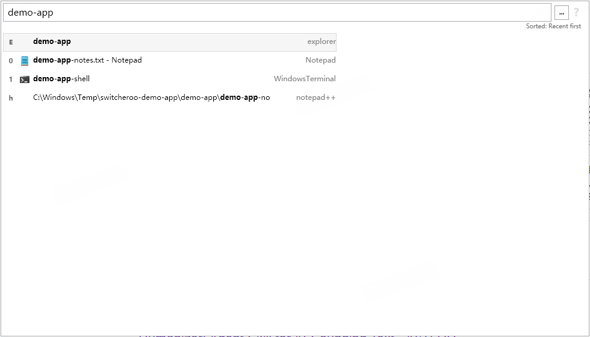
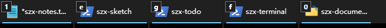
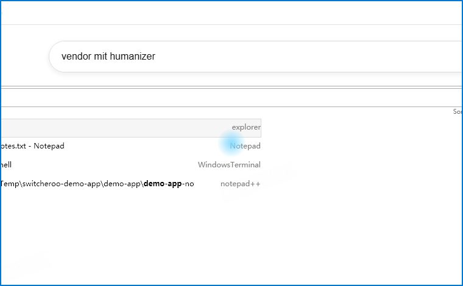
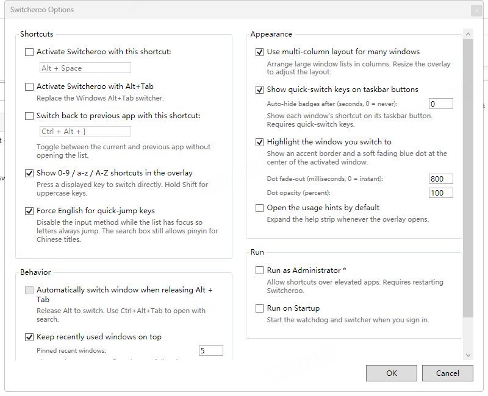
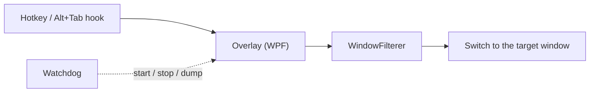

# Switcheroo Plus

[English](readme.md)

> Repository: https://github.com/friedikitty/switcheroo_plus
> Download: [GitHub Releases](https://github.com/friedikitty/switcheroo_plus/releases)
> What it does: a window switcher for Windows. Press `Alt + Space`, type a few letters from a title, jump to that window.

## TLDR

- Keyboard-first: skip the long `Alt + Tab` list. Search titles or press the key printed on a result.
- Fork of [Switcheroo](https://github.com/kvakulo/Switcheroo).
- Adds quick-jump keys, taskbar badges drawn by a separate helper, recent-first order, IME handling, switch feedback and a crash watchdog.
- Windows only. The runtime needs `.NET Framework 4.8`; building needs MSBuild and the targeting pack.
- Installer and portable zip live on Releases. The Chocolatey `switcheroo` package is the original, not this fork.
- Crash dumps contain process memory and window titles. They stay local; check them before sharing.

## Screenshots

- Real apps with harmless demo content. The `0-9` / `a-z` / `A-Z` labels are the jump keys.



- A separate helper draws the badges, so a badge bug cannot take the switcher down. Default hide time: `10` seconds.



- The dot blends into the window and fades out. Fade time and opacity are configurable.



- Two columns. New and missing settings use the saved baseline; explicit settings are kept.



## Quick start

### Prerequisites

| Dependency | Version | Why |
|---|---|---|
| Windows | `10` / `11` | Windows only |
| `.NET Framework` | `4.8` | runtime; a source build also needs the targeting pack |
| `MSBuild` | `VS2022` | source builds only |

### Install

- Download from [Releases](https://github.com/friedikitty/switcheroo_plus/releases).
- Take `switcheroo-setup.exe` or `switcheroo-portable.zip`.
- Build from source:

```powershell
git clone https://github.com/friedikitty/switcheroo_plus.git
cd switcheroo_plus
nuget restore Switcheroo.sln
msbuild Switcheroo.sln /p:Configuration=Release
```

- Build the setup or the portable zip:

```powershell
msbuild Installer\Build.xml /t:CreateSetup
msbuild Installer\Build.xml /t:CreatePortable
```

### Minimal example

```powershell
.\Switcheroo\bin\Release\switcheroo_plus.exe
```

Press `Alt + Space`. Type part of a window title, then press `Enter`; or press the jump key printed on the result.

## Usage

### Shortcuts

| Action | Shortcut | Notes |
|---|---|---|
| Open the overlay | `Alt + Space` | default; change it in Options |
| Replace `Alt + Tab` | `Alt + Tab` | optional; enable it in Options |
| Back to the previous app | `Ctrl + Alt + ]` | default; change it in Options |
| Jump to a result | `0-9` / `a-z` / `A-Z` shown on the row | `Shift` selects uppercase keys |
| Search | type, or press `/` | `/` moves focus to the search box |
| Move selection | `Tab` / `Shift + Tab` / `↑` / `↓` | |
| Open the selected window | `Enter` | with the unfiltered list, returns to the previous app |
| Close the selected window | `Ctrl + W` | the overlay stays open |
| Dismiss the overlay | `Esc` | |

### Options

| Setting | Default | Effect |
|---|---|---|
| Recent windows on top | `5` | most recent first, the rest alphabetical |
| Taskbar badge timeout | `10` seconds | `0` = never hide |
| Dot fade time | `800 ms` | `0` = park instantly |
| Dot opacity | `100%` | range `20` to `100` |
| Multi-column layout | on | wraps the list when there are many windows |
| Force English jump keys | on | suspends the IME while the result list has focus; the search box keeps it |
| Run on startup | off | installer or Options |

Config lives at `%USERPROFILE%\.config\.switcheroo_plus\config.jsonc`.

The old `%USERPROFILE%\switcheroo` path is migrated once on first launch.

### Entry points

| Script | Role |
|---|---|
| `build.ps1` | calls MSBuild at Idle priority, so a build does not starve the desktop |
| `Installer\Build.xml` | builds the setup and the portable zip |
| `AutomationTests\Run-All.ps1` | build, NUnit, watchdog and desktop acceptance suites |
| `switcheroo_plus_watchdog.exe` | normal launcher: tray icon, start/stop/restart, dumps |
| `switcheroo_plus_badges.exe` | helper process: draws taskbar shortcut badges and auto-hides them |

Starting `switcheroo_plus.exe` directly also routes through the watchdog.

It falls back to the core process only when the watchdog exe is missing.

## FAQ

| Symptom | Check |
|---|---|
| `Alt + Space` does nothing | another app may own the combo; pick another in Options or close the owner |
| Jump keys go into the IME | enable "Force English for quick-jump keys"; the search box keeps normal input |
| No taskbar badges | the badge helper restarts itself; check the tray control window if it stays empty |
| No blue frame after switching | check the highlight toggle and dot opacity |
| No automatic restart after a crash | by design; use Start or Restart in the tray menu |
| Dump size or privacy | only the latest `5` are kept; `core.dmp` holds process memory, review it before sharing |
| No highlight in a fullscreen game | exclusive fullscreen, secure desktops and protected surfaces are outside the pixel tests |

## How it works



- Window enumeration lives in `Core/`: top-level, visible, titled, non-tool windows.
- Ranking uses scores: prefix `4`, word-start or substring `2`, individual characters `1`; ties break by recency.
- The watchdog starts the core under a debugger in a kill-on-close job; its tray menu starts, stops and restarts it.
- An unhandled exception or CLR FailFast triggers an out-of-process `MiniDumpWriteDump`.
- About `10` seconds without a ping captures one hang dump; recovery stays manual.
- Badges are drawn by the separate `switcheroo_plus_badges.exe` helper; the switch frame uses small helper windows. Neither uses a full-screen overlay.
- Mixed-DPI placement uses the target window's DWM frame bounds.

### Watchdog and badge helper

| Process | Role |
|---|---|
| `switcheroo_plus_watchdog.exe` | normal launcher and tray shell |
| `switcheroo_plus_badges.exe` | taskbar badge renderer |

`switcheroo_plus_watchdog.exe` opens without a control window, owns the tray icon, and starts the core in a kill-on-close job. Right-click the tray icon for Start, Stop, Restart and scrolling logs. Startup and installer shortcuts target the watchdog; starting `switcheroo_plus.exe` directly forwards to it, and falls back to the core only when the watchdog exe is missing.

An unhandled exception or CLR FailFast captures an out-of-process full dump; a UI that goes about `10` seconds without a ping captures one hang dump. Recovery is manual. Incidents live under `%USERPROFILE%\.config\.switcheroo_plus\crashes\<timestamp-pid-guid>\` (`core.dmp`, `report.json`, `recent.log`), and the latest five are kept. `watchdog.log` rotates at `5 MB` with three backups.

`switcheroo_plus_badges.exe` is a persistent helper process. It finds taskbar buttons with UI Automation, caches their geometry, pre-creates a chip pool, and draws one small opaque click-through window per shortcut key. Badges auto-hide after `TaskbarBadgeTimeoutSeconds` (default `10`, `0` = never). If the helper dies the client respawns it; a badge failure never freezes the overlay.

## Limits and security

- Windows only; there is no macOS or Linux build.
- The `Alt + Tab` replacement is a low-level keyboard hook.
- It can conflict with other switchers, IMEs and remote-desktop tools. Turn it off first when something breaks.
- Crash dumps hold process memory and window titles.
- They stay local, at most five are kept, and nothing uploads automatically.
- Fullscreen games, secure desktops and protected surfaces are outside the pixel tests.
- They may still need a manual check.
- Acceptance tests never bypass UAC. Any elevation path is a manual check.

## Verification

```powershell
powershell -NoProfile -ExecutionPolicy Bypass -File AutomationTests\Run-All.ps1
```

- Builds Debug, runs NUnit, then starts isolated watchdog and core processes.
- The suites cover crash, hang, tray, startup and desktop checks.
- Results go to `.temp/acceptance/<timestamp>/results.json`; logs, screenshots and dumps sit in GUID subdirectories.
- CDB opens the dumps when Windows Debugging Tools are installed; missing CDB is reported as skipped.
- Unit tests only:

```powershell
packages\NUnit.ConsoleRunner.3.17.0\tools\nunit3-console.exe Core.UnitTests\bin\Debug\Switcheroo.Core.UnitTests.dll
```

## History

### Before `v0.10.0`

- The fork resumed from upstream `v0.9.2` with .NET Framework 4.8, NUnit 3 and modernized tooling.
- JSONC config at `~/.config/.switcheroo_plus` with legacy migration.
- Configurable activation and previous-app hotkeys, `0-9` / `a-z` / `A-Z` jump keys, previous-app toggle and CapsLock+Tab hook.
- Overlay work: focus on the list, `/` search, menu button, tray double-click, resizable popup, multi-column layout, case-sensitive jump keys up to 62.
- Named-pipe automation API and `--auto` test mode.
- Hotkey validation/persistence fixes and reliable switch-back/MRU ordering.
- Upstream 2018 features: Alt+Tab auto-switch, RunAsAdmin, multi-select, UWP process naming, `Alt+X` close and `Alt+J/K` navigation.

Those features were already in place when `v0.10.0` shipped. The watchdog shell and the badge-helper split followed in the `0.11` line.

### `v0.10.0` and the `0.11` line

- `v0.10.0` (2026-10-30): recent-on-top ordering, taskbar shortcut badges and hotkey conflict probe.
- `v0.11.0` (2026-11-02): badge rendering moved into `switcheroo_plus_badges.exe`; badge auto-hide; PID lookup removed a 1-2 s popup delay.
- `v0.11.1` (2026-11-03): badge cache and helper review fixes.
- `v0.11.2`–`v0.11.4` (2026-11-04): packaging, CI and docs fixes.

### After `v0.11.4`

- Hidden watchdog shell: tray control, start/stop/restart, crash and hang dumps, incident retention.
- Switch feedback: blue frame pulse plus a soft center dot that fades out.
- Recent windows pinned in recency order, with a `Recent` / `A–Z` toggle.
- Force-English quick-jump keys so an IME cannot swallow jump keys.
- Isolated acceptance suite, test-only feedback/passive-capture hooks and mixed-DPI placement.

## Files and maintenance

| Content | Location | Tracked |
|---|---|---|
| Window logic | `Core/` | yes |
| WPF shell | `Switcheroo/` | yes |
| Watchdog | `Watchdog/` | yes |
| Badge helper | `BadgeOverlay/` | yes |
| Installer and packaging | `Installer/`, `ChocolateyPackages/` | yes |
| Config | `%USERPROFILE%\.config\.switcheroo_plus\config.jsonc` | no |
| Crash dumps | `%USERPROFILE%\.config\.switcheroo_plus\crashes` | no |
| Watchdog log | `watchdog.log` in the same folder, `5 MB` rotation, `3` backups | no |
| Acceptance artifacts | `.temp/acceptance/` | no |

`packages/` is not tracked. Local builds and CI both run `nuget restore Switcheroo.sln` first.

## License / Credits

- Switcheroo is released under GNU GPL v3, see [`LICENSE.txt`](LICENSE.txt).
- Original author: James Sulak (2009).
- Regin Larsen has maintained the upstream project since 2014. This fork is maintained by friedikitty.
- Contributors: HellBrick, ovesen, philippotto, tarikguney, holymoo, elig0n, trond-snekvik.
- Dependency: [Managed Windows API](http://mwinapi.sourceforge.net) (LGPL).
- Dependency: [PortableSettingsProvider](https://github.com/crdx/PortableSettingsProvider) (MIT).

## Contributing

| What you want | Start here |
|---|---|
| Just use it | [Releases](https://github.com/friedikitty/switcheroo_plus/releases) |
| Report a bug | [Issues](https://github.com/friedikitty/switcheroo_plus/issues/new) |
| Propose a feature | open an issue first |
| Change code | `Fork -> Patch -> AutomationTests\Run-All.ps1 -> PR` |

Release tags and earlier upstream history live in [`changelog.md`](changelog.md).

If it saves you a few `Alt + Tab` presses, tell us what broke.


