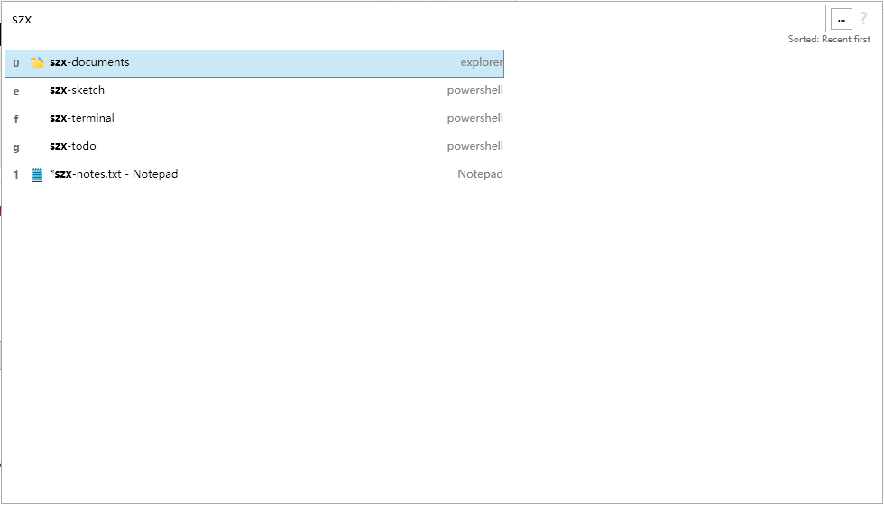
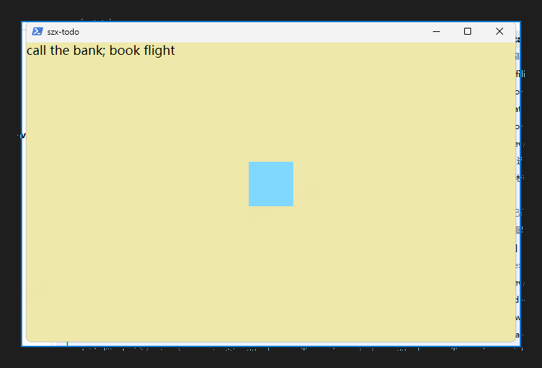
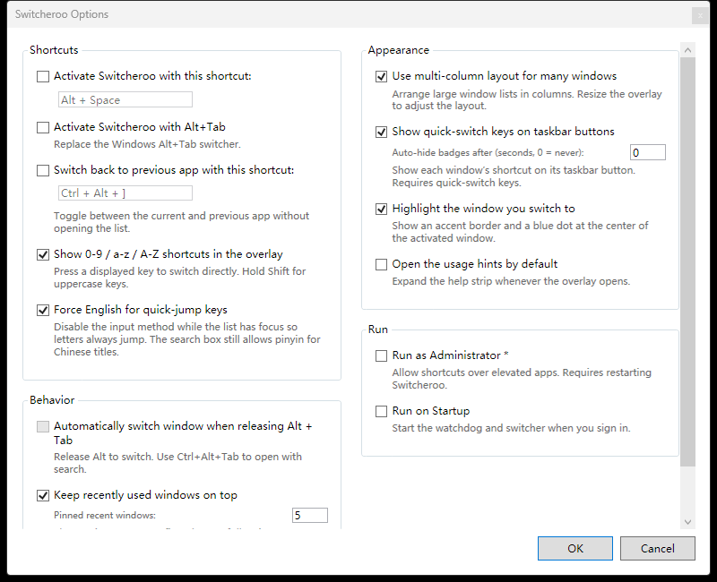

 Switcheroo Plus 
==========

Switcheroo Plus is for anyone who spends more time using a keyboard than a mouse.
Instead of alt-tabbing through a (long) list of open windows, Switcheroo lets
you jump straight to the window you want: search by title, press the displayed
shortcut character, or flip back to the previous app with a dedicated hotkey.

It is a fork of [Switcheroo](https://github.com/kvakulo/Switcheroo) that adds
quick-jump shortcut keys, taskbar key badges, recent-windows-on-top ordering,
input-method handling for quick jumps, switch feedback highlighting and a
crash watchdog.

## Screenshots

The search overlay with per-window quick-jump keys (staged demo windows):



The quick-switch keys are also drawn on the taskbar buttons, so you can jump
without even opening the overlay:


When you switch, the target window flashes a blue frame with a solid center
dot, so you can see at a glance where you landed:



All of it is configurable:




Download
--------

**[Download Switcheroo Plus here](https://github.com/friedikitty/switcheroo_plus/releases)**

If you use [Chocolatey](https://chocolatey.org), the original Switcheroo can be installed with `choco install switcheroo`.


Usage
-----

Action                         | Shortcut                | Remarks
------------------------------ | ----------------------- | ----------
Activate Switcheroo            | `Alt + Space`           | This shortcut can be customized in _Options_
Activate Switcheroo            | `Alt + Tab`             | Optional replacement for the built-in Windows switcher
Switch to previous app         | configurable            | Optional direct toggle without showing the overlay
_When Switcheroo is open_      |                         |
Quick jump to a result         | displayed `0-9` / `a-z` / `A-Z` | Press the character shown in the overlay; Shift switches to uppercase shortcuts
Search by text                 | `type` or `/`           | `/` focuses the search box if list navigation has focus
Move selection                 | `Tab`, `Shift + Tab`, `↑`, `↓` | Navigate the current result list
Toggle result ordering         | click `Recent` / `A–Z` under the search box | Recently used windows first, or plain alphabetical
Open selected window           | `Enter`                 | With the unfiltered list, Enter lands on the previous app
Close selected window          | `Ctrl + W`              |
Dismiss Switcheroo             | `Esc`                   |

Features
--------

- **Quick-jump shortcut keys.** Every listed window shows a `0-9` / `a-z` / `A-Z`
  key; press it to switch instantly. With _Force English for quick-jump keys_
  (on by default) the input method is suspended while the result list has focus,
  so an IME (Pinyin, etc.) cannot swallow the jump keys — the search box keeps
  your normal input method.
- **Recent windows on top.** Windows you actually used most recently lead the
  list (how many is configurable), the rest follow alphabetically, and the
  current foreground window sinks to the bottom so `Enter` flips back to the
  previous app. A toggle under the search box switches to plain A–Z ordering.
- **Taskbar badges.** Each window's quick-switch key is drawn at the top-left of
  its taskbar button by a separate helper process, so badge glitches can never
  take the switcher down. Badges auto-hide after a configurable timeout
  (0 = never).
- **Switch feedback.** The window you switch to is framed with a blue border
  pulse and a solid blue center dot for about a second — no more "where did I
  land?".
- **Previous-app hotkey and Alt+Tab hook.** Flip between two apps without the
  overlay, or let Switcheroo replace the built-in Alt+Tab, with optional
  auto-switch when you release Alt.
- **Quality of life.** Multi-column layout for many windows, resizable popup
  with remembered size, and optional usage hints shown in the empty overlay.


Watchdog and diagnostics
------------------------

Launch `switcheroo_plus_watchdog.exe`. It starts the switcher core with no control
window and owns the tray icon. Right-click the icon and choose **Show control
window** for Start, Stop, Restart and scrolling logs. Closing that window hides
it; Exit stops both processes. Starting `switcheroo_plus.exe` directly also routes
through the watchdog. Startup shortcuts and installer shortcuts target the watchdog.

An unexpected crash captures a full-memory dump in a separate worker, writes an
incident report and notifies you. Recovery is manual: choose Start or Restart.
The watchdog also checks UI responsiveness and attempts one hang dump per episode.
A recovered UI keeps its PID; a persistent hang can be restarted from the control
window. No automatic restart loop runs.

Diagnostics are under `%USERPROFILE%\.config\.switcheroo_plus\crashes`: each bundle
contains `core.dmp`, `report.json` and recent logs. Only the latest five bundles
are retained. `watchdog.log` rotates at 5 MB with three backups. Dump capture has a
30-second deadline, and a partial file is never published as a completed dump.
Dumps contain process memory and can contain window titles and other private data;
review them before sharing. Keep the matching release symbols for analysis.

The design follows Microsoft's [out-of-process MiniDumpWriteDump guidance](https://learn.microsoft.com/en-us/windows/win32/api/minidumpapiset/nf-minidumpapiset-minidumpwritedump)
and [debugger event lifecycle](https://learn.microsoft.com/en-us/windows/win32/debug/debugging-events).
Managed and native unhandled exceptions preserve the fault thread and exception
context. CLR FailFast can provide only an exit event; its dump retains remaining
memory but may lack the original fault context. Killing the watchdog also ends
its owned core/helper job. Ordinary external applications are not owned by that job.

_Options_ are grouped into Shortcuts, Behavior, Appearance and Run across two
columns. New and missing settings use the saved preference baseline; existing
explicit settings are preserved.


Automated verification
----------------------

Run `powershell -NoProfile -ExecutionPolicy Bypass -File AutomationTests\Run-All.ps1`.
See [the acceptance-test guide](AutomationTests/README.md) for coverage, isolation
and artifact details.


History
---------

Switcheroo was originally developed by [James Sulak](https://github.com/jsulak).

[Regin Larsen](https://github.com/kvakulo) took over the project in 2014 and is the current maintainer of the upstream project.

This fork ([switcheroo_plus](https://github.com/friedikitty/switcheroo_plus)) adds the features listed above.


How to contribute
-----------------

Please report any bug you encounter by [submitting an issue](https://github.com/friedikitty/switcheroo_plus/issues/new).

If you have an idea how to improve Switcheroo Plus, then don't be shy to submit it as well.

Pull requests are greatly appreciated. If you plan a larger feature, then please get in contact, so we can coordinate the efforts.


License
-------

Switcheroo is open source and is licensed under the [GNU GPL v. 3](http://www.gnu.org/licenses/gpl.html).

```
Copyright 2014, 2015 Regin Larsen
Copyright 2009, 2010 James Sulak
 
Switcheroo is free software: you can redistribute it and/or modify
it under the terms of the GNU General Public License as published by
the Free Software Foundation, either version 3 of the License, or
(at your option) any later version.

Switcheroo is distributed in the hope that it will be useful,
but WITHOUT ANY WARRANTY; without even the implied warranty of
MERCHANTABILITY or FITNESS FOR A PARTICULAR PURPOSE.  See the
GNU General Public License for more details.
 
You should have received a copy of the GNU General Public License
along with Switcheroo.  If not, see <http://www.gnu.org/licenses/>.
```


Credits
-------

[HellBrick](https://github.com/HellBrick), [ovesen](https://github.com/ovesen), [philippotto](https://github.com/philippotto), [tarikguney](https://github.com/tarikguney), [holymoo](https://github.com/holymoo), [elig0n](https://github.com/elig0n) and [trond-snekvik](https://github.com/trond-snekvik) have contributed to Switcheroo.

Switcheroo makes use of these great open source projects:

* [Managed Windows API](http://mwinapi.sourceforge.net), Copyright © 2006 Michael Schier, GNU Lesser General Public License (LGPL)
* [PortableSettingsProvider](https://github.com/crdx/PortableSettingsProvider), Copyright © crdx, The MIT License (MIT)
